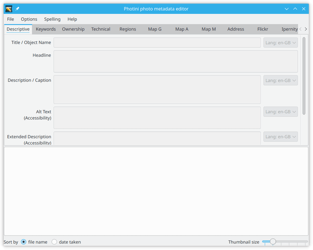
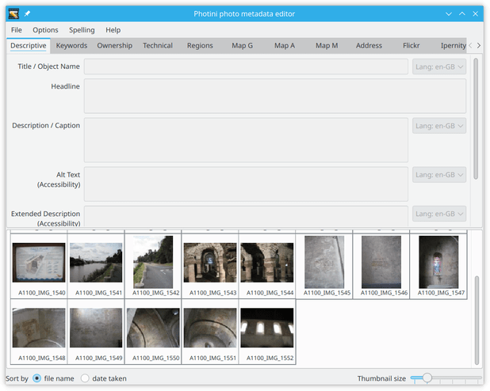
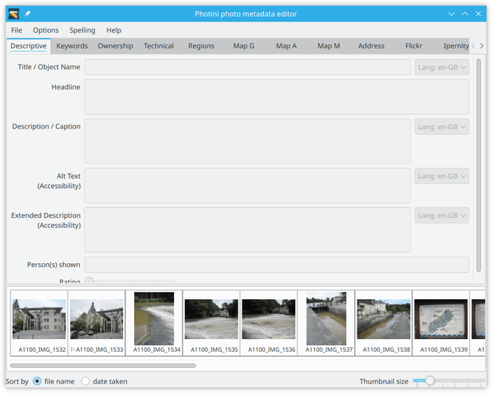
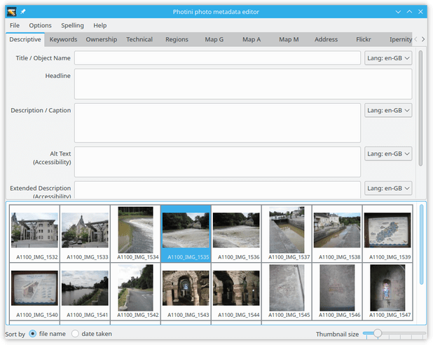
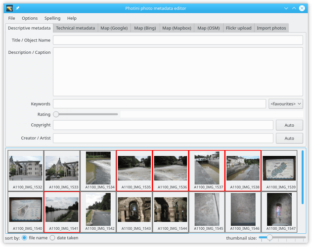
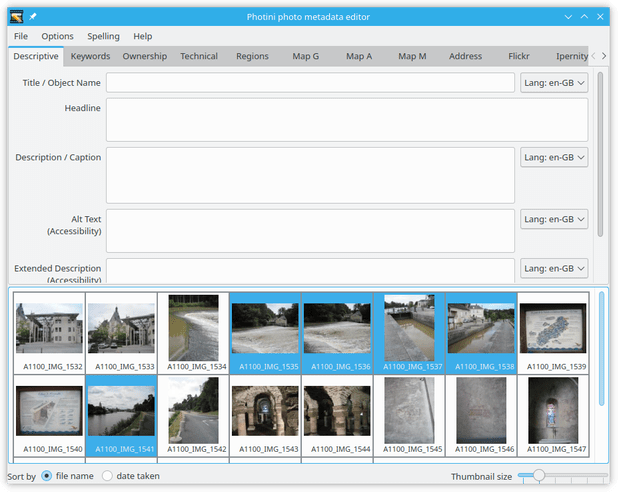
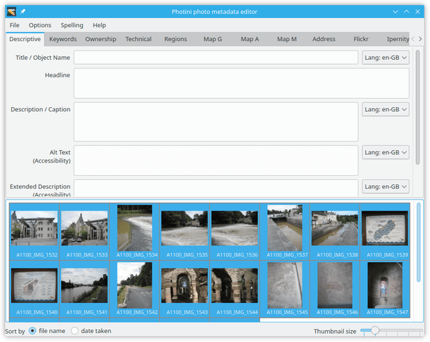
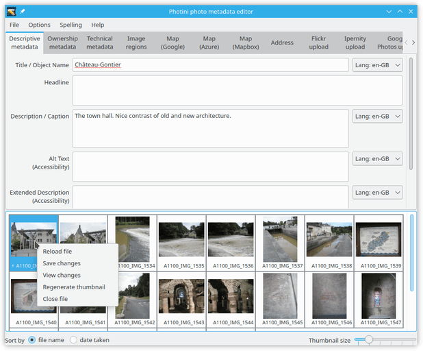
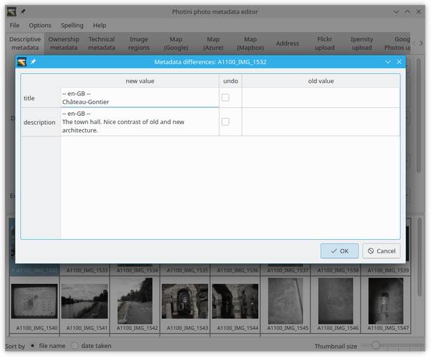
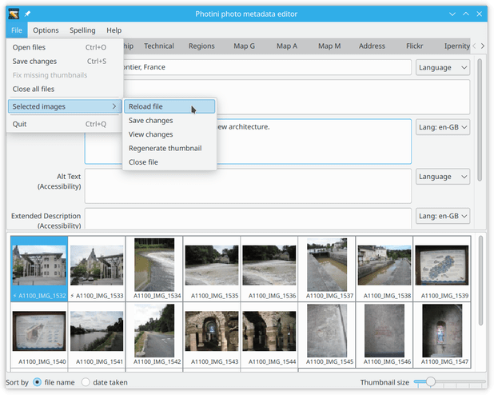

.. This is part of the Photini documentation.
   Copyright (C)  2012-26  Jim Easterbrook.
   See the file ../DOC_LICENSE.txt for copying conditions.

Image selector
==============

When you start the Photini editor it displays a GUI (graphical user interface) as shown below.
The exact appearance will depend on your operating system and window manager preferences, but the same functional elements should be present.
(The appearance can be altered by setting a different style, see the :ref:`configuration section <configuration-style>` for more detail.)

The Photini editor GUI has two main areas.
The upper part has a set of tabs to select different functions.
(The tabs can be re-ordered by dragging and dropping a tab to your preferred position.)
The lower part is an image selector that is common to all the tabs.
In between the two is a divider that can be dragged with the mouse to change the relative sizes of the two parts.
The overall size of the window can also be changed by dragging its edges or corners with the mouse.

Now load some images using the ``File`` menu ``Open files`` item (or its keyboard shortcut ``Ctrl+O``).
The loaded files are displayed as thumbnail images in the image selector part of the GUI.
Note that the thumbnail size can be changed with the slider control just beneath the thumbnail display area.
The files can also be sorted by name or date by clicking on the appropriate button.

Images can also be loaded by "drag and drop" from a file manager window or by adding them to the command line if you run Photini from a command terminal.
If you open a directory then all the images in that directory will be opened.
This is recursive, so beware of accidentally opening too many images in one go.

If you don't have a large screen you can reduce the image selector height to a single row.
In this mode it scrolls horizontally instead of vertically.

Clicking on any thumbnail selects that file.
The selected file is highlighted.
The colours used depend on your system configuration.
Double clicking on a thumbnail should display the full size image, using your computer's default image viewing application.

.. tip::

    If you change to a different image in the viewing application you may be able to right-click on the image and select "open with => Photini".
    This will select the image in Photini so you can be sure of editing the image you were just looking at.

Multiple files can be selected by holding down the 'shift' key while clicking on a second image.

To select multiple files that are not adjacent, hold down the 'control' key while clicking on the images.

The keyboard shortcut ``Ctrl+A`` selects all the loaded files.

Selecting multiple files allows you to set metadata, such as the image title, on several files at once.
This is much quicker than having to edit the metadata of each file separately.
You will probably want to select a different group of files before editing each metadata item.
For example, you might give the same title to all the images, then select only the first two or three before writing a description.

Context menu
------------

Right-clicking on a thumbnail displays a context menu for all the currently selected files.

The context menu currently has five items.
``Reload file`` discards any metadata changes.
``Save changes`` saves any changes to the file(s).
``View changes`` displays any changes of metadata, as shown below.
``Regenerate thumbnail`` creates a new thumbnail of the image(s).
``Close file`` closes the file(s).

The ``view changes`` context menu item displays all the metadata items that have changed.
In this example I've set two items that were previously empty.
If you want to discard any of these changes then select the appropriate ``undo`` checkboxes and click on ``OK``.

The same menu items also appear in a sub-menu of the main ``File`` menu.

Text decoding errors
--------------------

.. versionadded:: 2026.11.0

According to the Exif standard, most text values can only use ASCII characters, which doesn't allow the accented characters used in many languages.
Nowadays it is normal to use UTF-8 encoding to store non-ASCII text in Exif, but older image files may contain other encodings, e.g. iso-8859-1 (also known as latin-1).
If you open such files with Photini you should get error messages like these::

    10:18:38: WARNING: photini.exiv2: A1100_IMG_1532.JPG: Exif.Image.ImageDescription: failed to decode b'\xe2' in b'Ch\xe2teau-Gonti'
    10:18:38: WARNING: photini.exiv2: A1100_IMG_1532.JPG: Exif.Image.Copyright: failed to decode b'\xa9' in b'Copyright \xa92012 Jim E'
    10:18:38: WARNING: photini.exiv2: A1100_IMG_1532.JPG: Iptc.Application2.Copyright: failed to decode b'\xa9' in b'Copyright \xa92012 Jim E'

These messages show the first unrecognised character in a string, and a short extract from the string to show context.

You may also see ``�`` characters in Photini's text values::

    Ch�teau-Gontier, France
    Copyright �2012 Jim Easterbrook

Previous version of Photini would try to guess the encoding used for Exif and IPTC-IIM metadata, but this is not reliable for the small amount of available data.
Since version 2026.11.0 you need to tell Photini what encoding to use.
(The available encodings are listed in the `Python documentation`_.)

In this case I know that the hexadecimal values ``e2`` and ``a9`` are ``â`` and ``©`` in the latin-1 encoding, so I can tell Photini to use this encoding when loading the file::

    photini A1100_IMG_1532.JPG --charset latin-1

When Photini saves a file it converts all the metadata to UTF-8 encoding, so there is no need to tell it what charset to use when reopening the file.

Using Photini with other programs
---------------------------------

If you use other applications that can display or edit image metadata then you need to be careful when using them with Photini.
Just like with a word processor or text editor it can be risky to have a file open for editing in more than one program.
If you make changes in Photini you should save them before getting another program to reload or reopen the file.
If you make changes in another program you should use the context menu described above to reload the file in Photini.

You may also want to experiment with how other programs display the metadata you create in Photini and *vice versa*.
Be aware that other programs might not store their metadata in the picture files, but use a database or separate files (other than XMP sidecars).
Such programs are not compatible with Photini, unless they can be configured to use metadata standards.

.. _Python documentation:
    https://docs.python.org/3/library/codecs.html#standard-encodings
